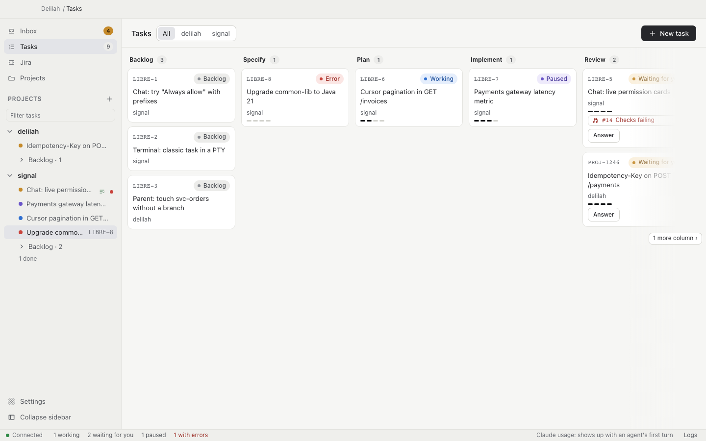

# Delilah

A lightweight macOS app that runs Claude Code agents in parallel, each in its own git
worktree, and pauses and resumes them around usage limits.

[](https://github.com/FranPerezFolgado/delilah/actions/workflows/ci.yml)
[](LICENSE)
[](https://github.com/FranPerezFolgado/delilah/releases/latest)
-lightgrey)

<picture>
  <source media="(prefers-color-scheme: dark)" srcset="docs/images/board-dark.png">
  
</picture>

## Why

- **Isolated workspaces.** Every task runs in its own git worktree (submodules
  included), so agents never step on each other or on your checkout.
- **Pause and resume on usage limits.** When an agent hits its usage limit, Delilah
  pauses it and resumes it on its own when the limit resets.
- **An Inbox of what needs you.** Questions, permission requests and finished work
  are gathered in one place, with notifications.
- **Lightweight.** About 195 MB in total with 12 agents running; see
  [Resource usage](docs/usage.md#resource-usage).

## Requirements

- macOS 13 or later on Apple Silicon.
- [Claude Code](https://docs.anthropic.com/en/docs/claude-code) installed and logged in.
  It is the only agent supported today.

## Install

One line, which downloads the latest release, verifies its checksum and installs
`Delilah.app` in `/Applications` (use `DELILAH_INSTALL_DIR=~/Applications` if that is not
writable):

```bash
curl -fsSL https://raw.githubusercontent.com/FranPerezFolgado/delilah/main/scripts/install.sh | bash
```

### Why the app is unsigned

Delilah is not signed with a paid Apple Developer account, so macOS blocks a copy
downloaded with a browser. Trust comes from checksums and build attestation instead
(see decisions [#79 and #80](docs/decisions.md)). The script above is not affected: it
downloads with `curl`, which does not quarantine files.

### Manual download

1. Download the DMG from the [latest release](https://github.com/FranPerezFolgado/delilah/releases/latest)
   and drag Delilah to `/Applications`.
2. Allow it to open, by either route:
   - run `xattr -dr com.apple.quarantine /Applications/Delilah.app`, or
   - open it once, then go to System Settings › Privacy & Security and choose
     **Open Anyway**. Right-click › Open no longer works since macOS Sequoia.

### Verify a download

From the folder with the downloaded assets:

```bash
shasum -a 256 -c SHA256SUMS --ignore-missing
gh attestation verify Delilah_aarch64.app.tar.gz --repo FranPerezFolgado/delilah
```

The checksum only shows the download is intact (`SHA256SUMS` comes from the same
release). The attestation shows the file was built by this repository's release
workflow; `SHA256SUMS` itself is attested too.

### Build from source

You need the Xcode Command Line Tools, Rust and Node 22 or later:

```bash
cd app && npm install && npm run dist
```

Details in [Building from source](docs/usage.md#building-from-source).

### Updates and uninstall

Updates install from inside the app and are not quarantined; see
[Updates](docs/usage.md#updates). To remove Delilah, see [Uninstall](docs/usage.md#uninstall).

## Quickstart

1. Install (see above) and open Delilah.app: it starts the daemon.
2. On first run, "Getting started" opens: choose "Add a project" and pick a git repo
   (or a parent repo with submodules).
3. Press "New task", type the ticket, a title and what you want done, then "Start":
   Delilah builds the task's workspace and starts Claude Code on it.
4. Follow it on the board and answer its questions and permission requests from the Inbox.

The desktop app is described in [docs/usage.md](docs/usage.md#desktop-app).

### Command line (optional)

The `delilah` command is not installed by the app. Build it from source (needs Rust):
`cargo build --release -p delilah-cli`, then use `target/release/delilah` or put it on your
PATH. See [Command line](docs/usage.md#command-line).

## Documentation

- [Documentation index](docs/README.md)
- [Usage](docs/usage.md): command line, desktop app, Jira, sessions
- [Architecture](docs/architecture.md)
- [Decisions](docs/decisions.md): what was decided and why
- [Development](docs/development.md): running, testing, releasing
- [Status](docs/status.md): what is built and what comes next

## Contributing

Issues and pull requests are welcome; see [CONTRIBUTING.md](CONTRIBUTING.md).

## Security

To report a vulnerability, see [SECURITY.md](SECURITY.md).

## License

[MIT](LICENSE)

---

Delilah is an independent project, not affiliated with or endorsed by Anthropic. Claude
and Claude Code are trademarks of Anthropic.
