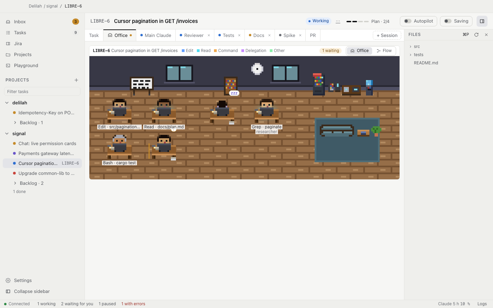
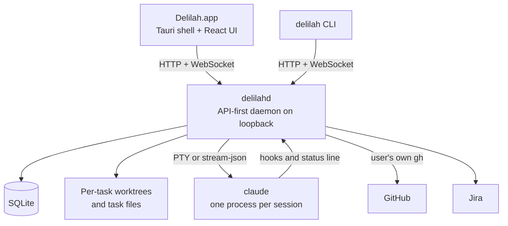

# Delilah

A macOS app that runs a team of Claude Code agents in parallel, from ticket to pull request,
and keeps them going across usage limits.

[](https://github.com/FranPerezFolgado/delilah/actions/workflows/ci.yml)
[](LICENSE)
[](https://github.com/FranPerezFolgado/delilah/releases/latest)

<picture>
  <source media="(prefers-color-scheme: dark)" srcset="docs/images/playground-dark.png">
  
</picture>

## The problem

Tickets live in Jira. The real work spans a parent repo with submodules, which plain
worktrees and most tools handle badly. One agent at a time wastes the day, and several at
once step on each other and on your checkout. Then the subscription limit hits mid-task and
everything stops until someone restarts it.

## What it does

- **Isolated workspaces.** A git worktree per task, submodules included.
- **Pauses on usage limits** and resumes by itself when they reset.
- **Inbox.** Questions, permission requests and finished work in one place, with notifications.
- **Playground.** Live sessions drawn as a pixel-art office: each character shows what its
  agent is doing.
- **From ticket to PR.** Jira import, with sub-tasks as subtasks, and pull request tracking
  with CI and reviews.
- **Phases and autopilot.** Spec, plan and implementation run as a chain of sessions with no
  one at the keyboard.
- **Model per phase and per task**, and a configurable start per project and task.
- **Light.** About 195 MB in total with 12 agents running; see
  [Resource usage](docs/usage.md#resource-usage).

## Architecture



The daemon does all the work, so agents keep going with the window closed (decision 7), and
the app and the CLI are equal clients of its API (decision 6). More in
[docs/architecture.md](docs/architecture.md).

## Decisions

Every decision, with what was ruled out, is in [docs/decisions.md](docs/decisions.md). Five
that shaped the project:

| # | Decision | Ruled out | Where |
|---|---|---|---|
| 1 | A local desktop app, one per person | A cloud service, a replacement for the company's own agent, a full IDE | [Product](docs/decisions.md#product) |
| 6 | API-first daemon: the app and CLI are equal clients | UI data through Tauri commands | [Architecture](docs/decisions.md#architecture) |
| 26 | GitHub through the user's `gh`, no token in the daemon | Storing a token and calling the API with `reqwest` or octocrab | [Pull requests](docs/decisions.md#pull-requests) |
| 58 | End-to-end tests against a fake Claude, `gh` and Jira | A shell fake, and a fake that posts to the hooks itself | [Working on Delilah](docs/decisions.md#working-on-delilah) |
| 67 | Chat mode on stream-json: go, adjusted by a spike | Nothing: the spike swapped the permission flag for `--permission-prompt-tool stdio` | [Fresh task bases](docs/decisions.md#fresh-task-bases) |

Decision 67 is there as an example of a decision settled by a spike rather than argued. The
links land on the section; the decision is the bold paragraph with that number.

## How it was built

Delilah is built with Delilah: one person directing Claude Code agents, with larger features
going through a written spec and plan first. Figures are as of 2026-11-02 at commit `b07a66b`.

| Figure | Value | What it counts |
|---|---|---|
| Active days | 12, between 2026-10-19 and 2026-11-02 | Days with at least one commit |
| Commits | 597 | Reachable from `b07a66b`, 33 of them merges |
| Releases | 11 tags | Up to v1.3.0 |
| Daemon, CLI and libraries | 94,526 lines | `crates/`: 93,073 of Rust, tests included, plus migrations and other files |
| TypeScript and CSS | 35,488 lines | `app/src`, tests included |
| Desktop shell | 585 lines | `app/src-tauri/src` |
| E2E | 1,723 lines | `app/e2e` |
| Scripts | 2,635 lines | `scripts/` |
| Specs | 31 features, 40,452 lines | `specs/` |
| Docs | 4,214 lines | `docs/` |
| Decisions | 106 entries | `docs/decisions.md` |
| Tests | 1,689 Rust, 1,175 vitest, 39 Playwright | Static count of declarations, not runs |
| Migrations | 26 | `crates/delilah-daemon/migrations` |

Lines are counted with `git ls-files` and `cat | wc -l`, excluding lockfiles, images and
generated files. The commands are in
[the feature's quickstart](specs/014-portfolio-readme/quickstart.md).

## Status

Used daily by its author. It is a personal tool and portfolio project: macOS on Apple
Silicon, Claude Code only. What is built and what is pending is in
[docs/status.md](docs/status.md).

## Install

Needs macOS 13 or later on Apple Silicon and
[Claude Code](https://docs.anthropic.com/en/docs/claude-code) installed and logged in. One
line downloads the latest release, verifies its checksum and installs `Delilah.app`:

```bash
curl -fsSL https://raw.githubusercontent.com/FranPerezFolgado/delilah/main/scripts/install.sh | bash
```

The app is not signed with a paid Apple Developer account; why, manual download,
verification, building from source, updates and uninstall are in
[docs/usage.md](docs/usage.md#install). First steps and the optional command line are in
[Getting started](docs/usage.md#getting-started).

## Documentation

- [Usage](docs/usage.md): every feature as the user sees it
- [Architecture](docs/architecture.md), [Decisions](docs/decisions.md)
- [Development](docs/development.md): running, testing, releasing
- [Status](docs/status.md) and the [documentation index](docs/README.md)

## Contributing, security and licence

Issues and pull requests are welcome, with no support commitment; see
[CONTRIBUTING.md](CONTRIBUTING.md) and [SECURITY.md](SECURITY.md). Licensed under
[MIT](LICENSE). The Playground's pixel art comes from
[pixtuoid](https://github.com/ivanwang123/pixtuoid) (MIT), credited in
[CREDITS.md](app/src/playground/CREDITS.md).

---

Delilah is an independent project, not affiliated with or endorsed by Anthropic. Claude
and Claude Code are trademarks of Anthropic.
