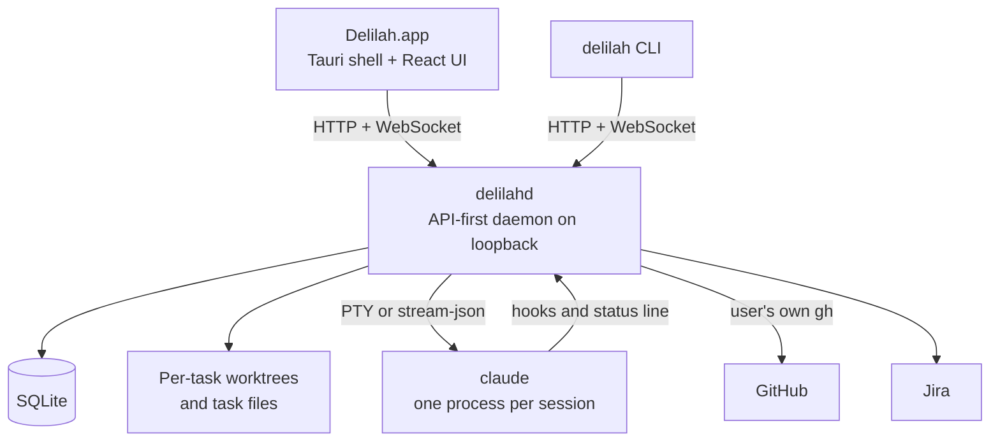

# README outline, for the owner's approval (FR-019)

**Status: NOT approved by the owner.** Autopilot self-approved the workflow phases, not this outline. T002 in `tasks.md` is the gate.

Figures taken at `e336e24` (v1.3.0).

## 1. Hero

- **Line**: "A macOS app that runs a team of Claude Code agents in parallel, from ticket to pull request, and keeps them going across usage limits." (Draft; final wording in T007.)
- **Visual**: the Playground, as a GIF if T004 passes, otherwise stills.
- **Badges**: CI, licence and latest release only.

## 2. The problem

Tickets live in Jira. The real work spans a parent repo with submodules, which plain worktrees and most tools handle badly. One agent at a time wastes the day, and several at once step on each other and on your checkout. Then the subscription limit hits mid-task and everything stops until someone restarts it. No work repository, company or ticket names appear.

## 3. What it does (8 bullets)

1. Isolated workspaces: a git worktree per task, submodules included.
2. Pauses on usage limits and resumes by itself when they reset.
3. Inbox: questions, permission requests and finished work in one place, with notifications.
4. Playground: live sessions drawn as a pixel-art office, where each character shows what its agent is doing.
5. From ticket to PR: Jira import, including sub-tasks as subtasks, and pull request tracking with CI and reviews.
6. Phases and autopilot: spec, plan and implementation run as a chain of sessions with no one at the keyboard.
7. Model per phase and per task, and a configurable start per project and task.
8. Light: about 195 MB in total with 12 agents running (figure from `docs/usage.md#resource-usage`).

Each bullet is re-checked against `docs/usage.md` in T007 (FR-013).

## 4. Architecture (Mermaid, rendered by GitHub)

Followed by 2-3 sentences on why: the daemon keeps agents working with the window closed (decision 7), and every client is equal (decision 6).

## 5. Decisions (5)

| # | Decision | Ruled out | Link |
|---|---|---|---|
| 1 | A local desktop app, one per person | A cloud service, a replacement for the company's own agent, a full IDE | `#product` |
| 6 | API-first daemon: the app and CLI are equal clients | UI data through Tauri commands | `#architecture` |
| 26 | GitHub through the user's `gh`, no token in the daemon | Storing a token and calling the API with `reqwest` or octocrab | `#pull-requests` |
| 58 | End-to-end tests against a fake Claude, `gh` and Jira | A shell fake, and a fake that posts to the hooks itself | `#working-on-delilah` |
| 67 | Chat mode on stream-json: go, adjusted by a spike | Nothing ruled out: the spike swapped the permission flag for `--permission-prompt-tool stdio` | `#fresh-task-bases` |

Four of the five have a real "ruled out"; 67 is there to show a decision settled by a spike, and the README must describe it that way. Decision 58's "local only" part was superseded by decision 85, so the README doesn't repeat it. Links land on the section, not the entry, so the text names the decision number ("Decision 67 in that section").

## 6. How it was built

Built with Delilah itself, by one person directing Claude Code agents, with larger features going through a written spec and plan first.

| Figure | Value | What it counts |
|---|---|---|
| Calendar days | 10 (2026-10-19 to 2026-10-28) | First to last commit; commits on all 10 |
| Commits | 585 | Reachable from `main`, 33 of them merges |
| Releases | 11 tags | Up to v1.3.0 |
| Daemon, CLI and libraries | 94,526 lines | `crates/`: 92,073 of Rust, tests included, plus migrations and other files |
| TypeScript and CSS | 35,488 lines | `app/src`, tests included |
| Desktop shell | 585 lines | `app/src-tauri/src` |
| E2E | 1,659 lines | `app/e2e` |
| Scripts | 2,635 lines | `scripts/` |
| Specs | 30 features, 39,651 lines | `specs/` |
| Docs | 4,120 lines | `docs/` |
| Decisions | 105 entries | `docs/decisions.md` |
| Tests | 1,689 Rust, 1,175 vitest, 36 Playwright | Static count of declarations, not runs |
| Migrations | 26 | `crates/delilah-daemon/migrations` |

## 7. Status

Used daily by its author. A personal tool and portfolio project: macOS on Apple Silicon, Claude Code only. Link to `docs/status.md`.

## 8. Install, docs, licence

Requirements, the one-line command and a link to `docs/usage.md#install`. Documentation links, a line on contributing with its stance, MIT, the pixtuoid art credit, and the non-affiliation disclaimer.

Target: 150-200 lines, at most a quarter about install.
